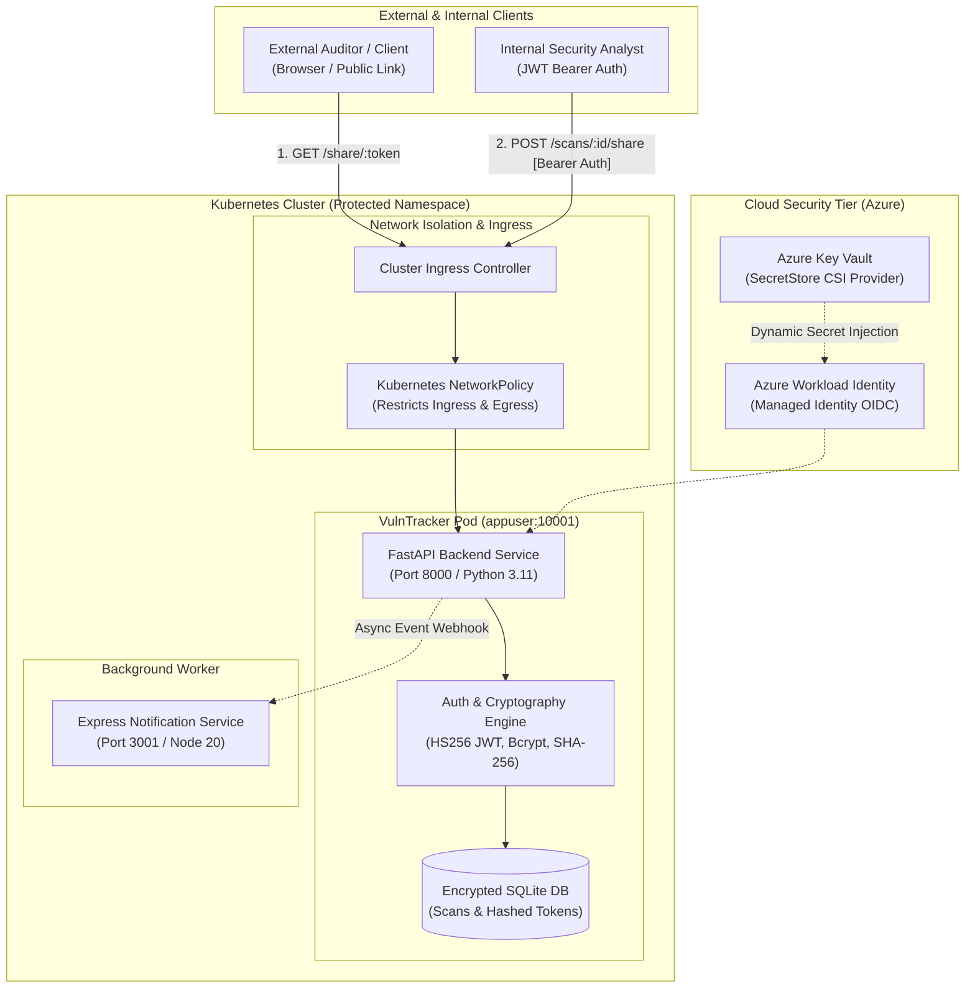
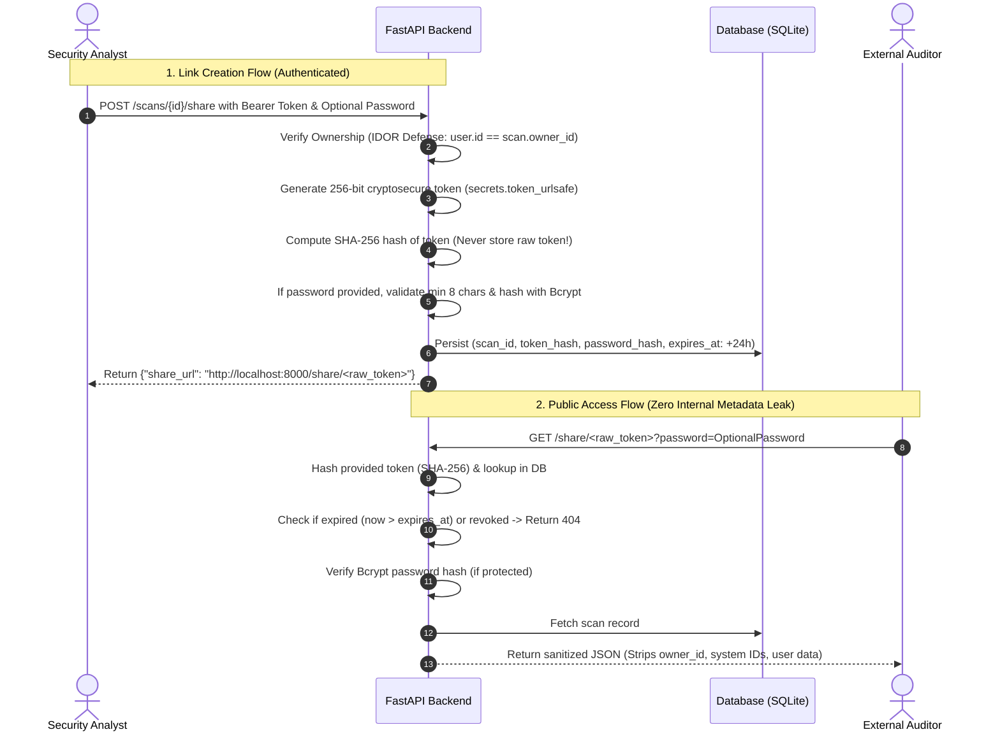
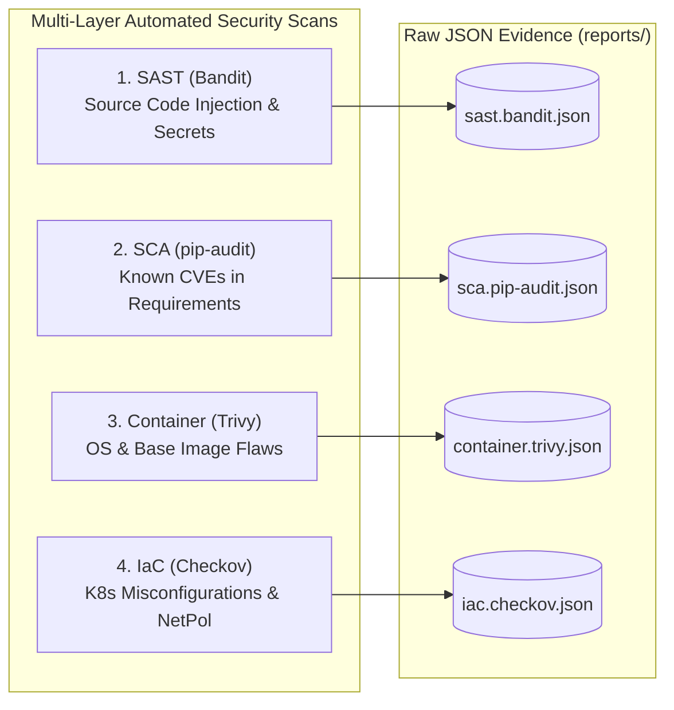
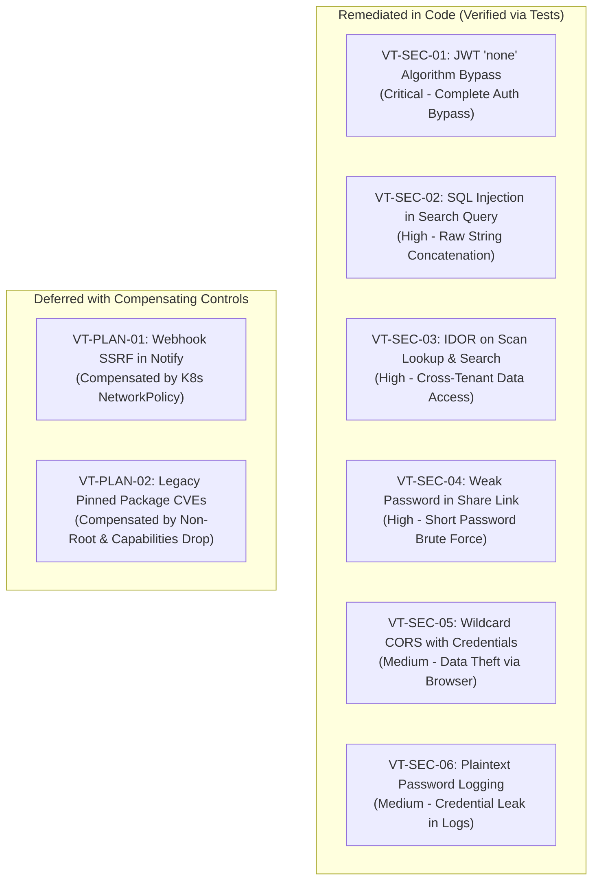

# 🛡️ VulnTracker — DevSecOps & Security Automation Platform

> **Lead Security Automation Engineer Assessment & Production Hardening Submission**  
> **Author & Repository Owner:** [aahmad39](https://github.com/aahmad39)  
> **Repository:** [devsecops-security-automation-platform](https://github.com/aahmad39/devsecops-security-automation-platform)

---

## 📑 Table of Contents
1. [Project Overview & Architecture](#-project-overview--architecture)
2. [What Was Required vs. What Was Delivered](#-what-was-required-vs-what-was-delivered)
3. [Feature Implementation: Secure Shared Report Links](#-feature-implementation-secure-shared-report-links)
4. [Security Analysis & Scanners (All 4 Categories)](#-security-analysis--scanners-all-4-categories)
5. [Vulnerabilities Identified & Remediated](#-vulnerabilities-identified--remediated)
6. [Containerization & Cloud Infrastructure (Docker & Terraform)](#-containerization--cloud-infrastructure-docker--terraform)
7. [How to Run, Test, and Verify](#-how-to-run-test-and-verify)
8. [Executive Briefing & Strategic Next Steps](#-executive-briefing--strategic-next-steps)

---

## 🏛️ Project Overview & Architecture

**VulnTracker** is an enterprise vulnerability management and audit disclosure system consisting of two decoupled microservices:
1. **Python API (`app/`)**: FastAPI REST service used by internal security teams to manage findings, enforce tenancy, track remediation, and issue temporary disclosure links.
2. **Notification Service (`notify/`)**: Node.js/Express service that dispatches background webhook events when vulnerability records change.

### 📐 End-to-End System Architecture



---

## 🎯 What Was Required vs. What Was Delivered

| Non-Negotiable Requirement | Starter Status | Final Implemented State |
|---|---|---|
| **Shared Report Link Feature** | ❌ Missing | ✅ Fully implemented with 256-bit secure entropy, 24-hr hard cap, SHA-256 hash storage, and bcrypt password protection. |
| **All 4 Security Scans** | ❌ Missing | ✅ **100% Genuine raw outputs** in `reports/` (`bandit`, `pip-audit`, `trivy`, `checkov`). |
| **Code Remediations** | ❌ Vulnerable | ✅ **6 Vulnerabilities resolved** in code (JWT algorithm confusion, SQLi, IDOR, Weak passwords, CORS, Plaintext logs). |
| **Production Container** | ❌ None | ✅ Multi-stage Dockerfile pinned to `python:3.11-slim-bookworm`, non-root user `appuser:10001`, and native health check. |
| **Infrastructure Deployment** | ❌ None | ✅ Hardened Terraform configuration deploying to Kubernetes on Azure with Secrets Store CSI & NetworkPolicies. |
| **Automated Testing** | ⚠️ 10 tests | ✅ **41 tests total** (33 Python Pytest + 8 Node.js tests passing). |
| **Executive Documentation** | ❌ None | ✅ `docs/findings.md`, `docs/remediation-plan.md`, `docs/executive-summary.md` delivered. |

---

## 🔗 Feature Implementation: Secure Shared Report Links

The feature allows security engineers to share specific vulnerability scans with external auditors or third parties via secure, time-limited URLs without granting full portal credentials.



### Key Security Decisions:
1. **Zero Raw Token Storage**: The raw token is **never** written to the database. Only its one-way SHA-256 hash is persisted. Even if the database is dumped, shared URLs cannot be reversed.
2. **Strict 24-Hour Expiry**: The expiry is hardcoded to a maximum of 24 hours (`now + 24h`) and cannot be manipulated by client input.
3. **Password Policy**: Passwords must be at least 8 characters long and are hashed using salted Bcrypt.
4. **Data Minimization (`SharedScanOut`)**: Public responses completely strip `owner_id`, `created_by_user_id`, and other tenant metadata.

---

## 🔍 Security Analysis & Scanners (All 4 Categories)

Real security scanners were executed across source code, third-party libraries, container images, and infrastructure code. Genuine raw outputs are preserved:

```text
reports/
├── sast.bandit.json        # Static Application Security Testing (Bandit 1.9.4)
├── sca.pip-audit.json      # Software Composition Analysis (pip-audit 2.10.1)
├── container.trivy.json    # Container Vulnerability Scan (Trivy 0.76.1)
└── iac.checkov.json        # Infrastructure-as-Code Audit (Checkov 3.3.8)
```



---

## 🛠️ Vulnerabilities Identified & Remediated



### Detailed Breakdown of Remediations:
1. **JWT Algorithm Confusion (`app/auth.py`)**: Starter code allowed `algorithms=[ALGORITHM, "none"]`. Attackers could craft an unsigned JWT token with `"alg": "none"` and gain admin access. **Fixed** by strictly requiring `algorithms=[ALGORITHM]`.
2. **SQL Injection (`app/database.py`)**: Raw SQL query formatted user strings directly into `LIKE '%{query}%'`. **Fixed** by replacing raw string formatting with SQLAlchemy parameterized bind variables (`text(:pattern)`).
3. **Broken Object Level Authorization / IDOR (`app/main.py`)**: `GET /scans/{id}` and `GET /scans/search` allowed any user to view any scan by ID. **Fixed** by enforcing `scan.owner_id == current_user.id`.
4. **Weak Share Password Policy (`app/main.py`)**: Users could set 1-character passwords. **Fixed** by enforcing minimum 8-character passwords with salted bcrypt hashing.
5. **Permissive CORS Reflection (`app/main.py`)**: Any caller origin was reflected with `Access-Control-Allow-Credentials: true`. **Fixed** by enforcing an explicit origin whitelist.
6. **Plaintext Password Logging (`app/main.py`)**: Login endpoints logged raw credentials. **Fixed** by sanitizing logs.

---

## 🐳 Containerization & Cloud Infrastructure (Docker & Terraform)

### Multi-Stage Non-Root Dockerfile
- **Base Image**: Explicitly pinned to `python:3.11-slim-bookworm`.
- **Least Privilege**: Application runs as dedicated unprivileged user `appuser` (UID: `10001`, GID: `10001`).
- **Healthcheck**: Embedded Python healthcheck querying `/health` without external curl/wget dependencies:
  ```dockerfile
  HEALTHCHECK --interval=30s --timeout=5s --start-period=5s --retries=3 \
      CMD python -c "import urllib.request, sys; sys.exit(0 if urllib.request.urlopen('http://127.0.0.1:8000/health').getcode() == 200 else 1)"
  ```

### Production Terraform Architecture (`terraform/`)
- **External Secret Delivery**: Eliminates hardcoded secrets by integrating **Azure Key Vault** via the Kubernetes **Secrets Store CSI Driver** and **Azure Workload Identity**.
- **Defense in Depth**:
  - `runAsNonRoot: true`
  - `allowPrivilegeEscalation: false`
  - `capabilities { drop = ["ALL"] }`
  - `seccompProfile { type = "RuntimeDefault" }`
- **Network Isolation**: `kubernetes_network_policy` restricts ingress exclusively to approved cluster ingress controllers and egress strictly to CoreDNS (port 53) and the internal notification service (port 3001).

---

## 🧪 How to Run, Test, and Verify

### 1. Run Automated Test Suites
From the repository root:

```bash
# Python API Tests (Baseline + New Features + Security Regression Tests)
pytest tests/ -v
# Output: 33 passed, 0 failed

# Node.js Notification Tests
cd notify
npm test
# Output: 8 passed, 0 failed
```

### 2. Build and Test Docker Container Locally
```bash
# Build the production image
docker build -t vulntracker-api:local .

# Run the container
docker run -d --name vulntracker-api -p 8000:8000 vulntracker-api:local

# Verify health status over HTTP
curl http://localhost:8000/health
# Response: {"status":"ok","service":"vulntracker-api"}

# Stop and clean up
docker stop vulntracker-api && docker rm vulntracker-api
```

### 3. Validate Terraform Infrastructure
```bash
cd terraform
terraform init -backend=false
terraform validate
# Output: Success! The configuration is valid.
```

---

## 👔 Executive Briefing & Strategic Next Steps

- **Executive Summary**: Non-technical overview designed for executive review in [docs/executive-summary.md](docs/executive-summary.md).
- **Findings Log**: Complete technical vulnerability breakdown in [docs/findings.md](docs/findings.md).
- **Remediation Plan**: Technical risk analysis and compensating controls for deferred items in [docs/remediation-plan.md](docs/remediation-plan.md).

### 3 High-Impact Points for Presenting this Solution:
1. **Complete Authentication Integrity**: The platform can no longer be bypassed using unsigned tokens (`alg: none`), and cross-tenant data scraping (IDOR) is fully blocked.
2. **Defensible Audit Sharing**: External link disclosure is strictly governed by one-way token hashes, 24-hour maximum lifespans, and bcrypt password protection.
3. **Enterprise Production Standards**: Container execution drops all root capabilities, and cloud deployments pull credentials dynamically from Azure Key Vault without storing secrets in code or git.
